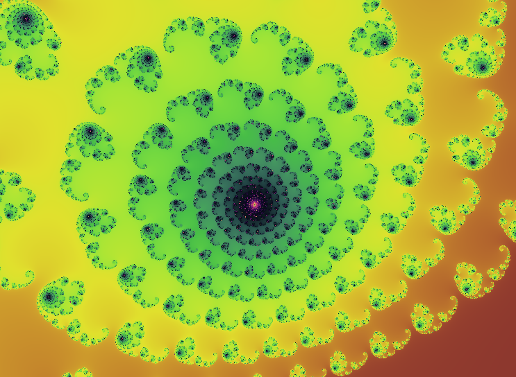
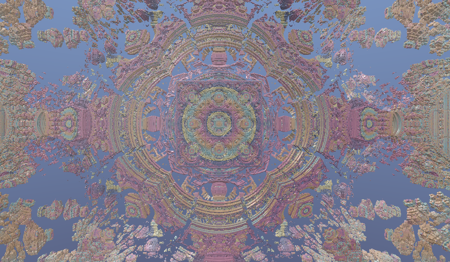

# Fractal Viewer

A real-time 2D and 3D fractal visualizer running in the browser, built with Vue 3 and WebGL/WebGPU shaders.

**Live Demo**: [https://quoruda.github.io/FractalViewer/](https://quoruda.github.io/FractalViewer/)

## Preview

| 2D Fractal (Julia / Mandelbrot) | 3D Fractal (Mandelbox Raymarching) |
| :---: | :---: |
|  |  |

## Features

### Supported Fractals
- **Julia Set (2D)**: Interactive tuning of real ($r$) and imaginary ($i$) parameters via sliders, with a demo mode smoothly interpolating between over 30 classic presets (Douady rabbit, Siegel disk, dendritic spirals, etc.).
- **Mandelbrot Set (2D)**: Deep iteration rendering with smooth color cycling.
- **Burning Ship (2D)**: Absolute-value variant producing flame-like structures.
- **Mandelbox (3D)**: Real-time raymarched 3D fractal based on box and sphere folding distance estimation. Includes adjustable scale, fold limits, camera pitch/yaw rotation, ambient occlusion, and orbit-trap coloring.

### Navigation & Controls
- **Mouse**: Click and drag to pan (or rotate the 3D camera), scroll wheel to zoom at cursor position.
- **Touch**: Single-finger drag, pinch to zoom.
- **Interface**: Collapsible navigation overlay and real-time parameter sliders.

### Technical Overview
- **Vue 3** (Composition API) + **Vite**.
- **Vue Router** with hash mode for GitHub Pages compatibility.
- Modular renderer system (`RendererFactory`) handling WebGL (GLSL) with automated fallback and experimental WebGPU (WGSL) support.

## Getting Started

### Prerequisites

- Node.js `^20.19.0` or `>=22.12.0`
- A browser supporting WebGL

### Installation

```bash
git clone https://github.com/Quoruda/FractalViewer.git
cd FractalViewer
npm install
```

### Development Server

```bash
npm run dev
```

### Production Build

```bash
npm run build
```

To preview the build locally:

```bash
npm run preview
```

### Deployment

Deploy to GitHub Pages:

```bash
npm run deploy
```

### Linting

```bash
npm run lint
```

## License

MIT
